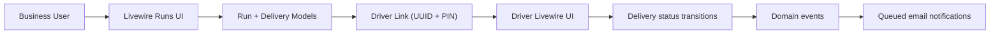

# DeliverEase Technical Overview

## 1. Project Summary

DeliverEase is a Laravel 12 application for small businesses that run their own local deliveries.  
It gives business users a way to:

- Create and manage ordered delivery runs
- Share secure run links (UUID + PIN) with drivers
- Let drivers progress through deliveries on a mobile-first interface
- Automatically email customers when they are next or one stop away

The app is built as a server-driven web application using Livewire v4 and Flux UI components.

## 2. Tech Stack

### Backend

- PHP `^8.2` (team target in local tooling: PHP 8.4)
- Laravel Framework `^12.0`
- Livewire `^4.0@beta`
- Flux UI / Flux Pro `^2.9`
- Laravel Sanctum `^4.2` (installed)
- Laravel Horizon `^5.40` (installed)
- Laravel Socialite + Keycloak provider (installed)
- `ohffs/simple-spout` for Excel import/export

### Frontend

- Vite `^7.2.6`
- Tailwind CSS v4
- Flux CSS (`vendor/livewire/flux/dist/flux.css`)
- Minimal JS entrypoint (`resources/js/app.js`, `resources/js/bootstrap.js`)

### Testing / Quality

- Pest v4 + pest-plugin-laravel
- RefreshDatabase for feature tests
- Laravel Pint for formatting

## 3. Architecture Overview

DeliverEase follows a standard Laravel structure with Livewire page components as the primary UI and behavior boundary.

- Routing is defined in `routes/web.php` and `routes/sso-auth.php`
- Business-facing pages are Livewire components behind `auth` middleware
- Driver-facing pages are public, gated by PIN and session checks
- Domain logic is concentrated in Eloquent models (`Run`, `Delivery`)
- Status transitions dispatch events
- Event listeners send queued mail notifications

### High-level flow

## 4. Core Domain Model

## `Business`
- File: `app/Models/Business.php`
- Owns many `users` and many `runs`

## `User`
- File: `app/Models/User.php`
- Belongs to `business`
- Used for owner/dispatcher authentication

## `Run`
- File: `app/Models/Run.php`
- Key fields: `uuid`, `business_id`, `created_by_user_id`, `name`, `pin`, `status`, timestamps
- Lifecycle: generates UUID on create (`booted`)
- Casts `status` to `RunStatus` enum
- Helper methods:
  - `getDriverUrl()`
  - status checks (`isPending`, `isStarted`, `isCompleted`)
  - state transitions (`start`, `markCompleted`)
  - progress helpers (`currentDelivery`, `nextPendingDelivery`, `completedDeliveriesCount`)

## `Delivery`
- File: `app/Models/Delivery.php`
- Key fields: `run_id`, `email`, `name`, `position`, `status`, timestamps
- Casts `status` to `DeliveryStatus` enum
- Scopes: `pending`, `notified`, `completed`
- Helpers:
  - `display_name` accessor (name fallback to email)
  - status checks
  - transitions (`markAsNotified`, `markAsCompleted`)

## Enums
- `app/Enums/RunStatus.php`: `Pending`, `InProgress`, `Completed`
- `app/Enums/DeliveryStatus.php`: `Pending`, `Notified`, `Completed`

## 5. Data Schema

Key tables and relationships:

- `businesses`
- `users` (`business_id` nullable FK)
- `runs` (`business_id` FK, `created_by_user_id` FK, unique `uuid`)
- `deliveries` (`run_id` FK, unique `[run_id, position]`)

Important migrations:

- `database/migrations/2025_12_06_112057_create_businesses_table.php`
- `database/migrations/2025_12_06_112110_create_runs_table.php`
- `database/migrations/2025_12_06_115150_create_deliveries_table.php`
- `database/migrations/2025_12_06_115126_add_business_id_to_users_table.php`

## 6. Core User Flows

### A) Business user creates and manages runs

Livewire components:

- `app/Livewire/Runs/Index.php` and `resources/views/livewire/runs/index.blade.php`
- `app/Livewire/Runs/Create.php` and `resources/views/livewire/runs/create.blade.php`
- `app/Livewire/Runs/Edit.php` and `resources/views/livewire/runs/edit.blade.php`
- `app/Livewire/Runs/Show.php` and `resources/views/livewire/runs/show.blade.php`

Capabilities:

- CRUD for runs
- Ordered delivery stop management (`wire:sort`)
- Status filter on list via URL param (`#[Url] public $status`)
- Share modal exposes driver URL + PIN
- Export run data to XLSX

Authorization:

- `RunPolicy` enforces business ownership and status-based update/delete rules

### B) Driver access and completion flow

Livewire components:

- `app/Livewire/Driver/AccessRun.php`
- `app/Livewire/Driver/ActiveRun.php`

Behavior:

- Driver opens `/driver/run/{uuid}`
- Enters 4-digit PIN
- PIN attempts are rate-limited per run/IP (`RateLimiter`)
- Valid PIN sets session key `driver_run_{uuid}`
- Driver starts run, then marks notified deliveries complete

### C) Notification cascade

Events:

- `RunStarted` (`app/Events/RunStarted.php`)
- `DeliveryCompleted` (`app/Events/DeliveryCompleted.php`)

Listeners:

- `SendInitialNotifications`: first stop gets "You’re next", second gets "One stop away"
- `SendNextDeliveryNotifications`: each completion advances notifications and auto-completes run when exhausted

Mailables (queued):

- `YouAreNextMail` (`app/Mail/YouAreNextMail.php`)
- `OneStopAwayMail` (`app/Mail/OneStopAwayMail.php`)

Markdown templates:

- `resources/views/emails/you-are-next.blade.php`
- `resources/views/emails/one-stop-away.blade.php`

## 7. Import / Export

### Import

- Component: `app/Livewire/Runs/Import.php`
- View: `resources/views/livewire/runs/import.blade.php`
- Uploads `.xlsx` / `.xls`
- Reads first sheet with `ExcelSheet->importFirst()`
- Skips likely header row if first row fails validation
- Normalizes emails to lowercase
- Updates existing delivery by email or appends as new position

### Export

- Controller: `app/Http/Controllers/RunExportController.php`
- Route: `GET /runs/{run}/export`
- Generates XLSX with Name/Email/Status/Notified/Completed timestamps
- Returns downloadable file with run name + date

## 8. Authentication and Authorization

### Active auth path

- Login/logout controller:
  - `app/Http/Controllers/Auth/LoginController.php`
- Routes:
  - `GET /login`
  - `POST /login` (throttled: `throttle:login`)
  - `POST /logout`

Custom rate limit:

- `AppServiceProvider::boot()` defines `login` limiter (5/min per IP+email)

### Authorization

- `app/Policies/RunPolicy.php`
- Livewire components call `$this->authorize(...)` for view/create/update/delete gates

## 9. UI and Frontend Structure

- Main authenticated shell: `resources/views/layouts/app.blade.php`
  - Flux sidebar/header
  - `wire:navigate` links
  - logout actions
- Dashboard UI: `resources/views/livewire/dashboard.blade.php`
- Driver mobile UI: `resources/views/livewire/driver/*.blade.php`
- Landing page: `resources/views/welcome.blade.php` (custom marketing page with Alpine-based dark-mode toggle)

Build pipeline:

- Vite config: `vite.config.js`
- CSS entry: `resources/css/app.css`
- JS entry: `resources/js/app.js`

## 10. Seed Data and Local Development

Seeder strategy:

- Team convention uses `TestDataSeeder` for local seed data
- File: `database/seeders/TestDataSeeder.php`

It creates:

- A business
- A test user (`test@example.com` / `secret`)
- A pending run and an in-progress run with delivery samples

Local environment files:

- `.lando.yml` for Lando workflow
- `docker-compose.yml` and `Dockerfile` for containerized environments

## 11. Testing Coverage

Feature tests live in `tests/Feature` and use Pest.

Key coverage areas:

- Auth login + throttling (`tests/Feature/Auth/LoginTest.php`)
- Dashboard metrics and setup flow (`tests/Feature/DashboardTest.php`)
- Run CRUD and authorization behavior (`tests/Feature/RunManagementTest.php`)
- Driver PIN/session access rules (`tests/Feature/DriverAccessTest.php`)
- Driver progress + notification cascade (`tests/Feature/RunDriverTest.php`)
- Import/export behavior (`tests/Feature/ImportExportTest.php`)

Testing setup:

- `tests/Pest.php` extends `Tests\TestCase` and applies `RefreshDatabase` to Feature tests.

## 12. Route Map (Current)

The current route list (14 routes) includes:

- Public:
  - `/` (landing / redirect behavior)
  - `/login`, `POST /login`
  - Driver run access and active pages
- Authenticated:
  - `/dashboard`
  - `/runs` index/create/show/edit/import/export
  - `POST /logout`

## 13. Key Files by Concern

### Domain and business logic
- `app/Models/Run.php`
- `app/Models/Delivery.php`
- `app/Policies/RunPolicy.php`
- `app/Enums/RunStatus.php`
- `app/Enums/DeliveryStatus.php`

### Livewire app surfaces
- `app/Livewire/Dashboard.php`
- `app/Livewire/Runs/*.php`
- `app/Livewire/Driver/*.php`
- `resources/views/livewire/**/*.blade.php`

### Notifications
- `app/Events/*.php`
- `app/Listeners/*.php`
- `app/Mail/*.php`
- `resources/views/emails/*.blade.php`

### Auth and routing
- `routes/web.php`
- `routes/sso-auth.php`
- `app/Http/Controllers/Auth/LoginController.php`
- `app/Providers/AppServiceProvider.php`

### Data and test scaffolding
- `database/migrations/*.php`
- `database/factories/*.php`
- `database/seeders/TestDataSeeder.php`
- `tests/Feature/*.php`

## 14. Current Implementation Notes

During repository review, a few technical notes are worth tracking:

- `routes/sso-auth.php` and `routes/web.php` both define behavior for `/`, creating overlapping root route definitions.
- `SSOController` and `SSOServiceProvider` exist, but active route registration currently points to `LoginController` only.
- `bootstrap/providers.php` currently lists only `AppServiceProvider`, so `SSOServiceProvider` is not explicitly registered there.
- `TestDataSeeder` contains an unused variable (`$inProgressPin`) and includes a sample PIN that exceeds 4 digits before replacement.

These notes do not prevent the documented core flows from working, but they are useful cleanup candidates.

